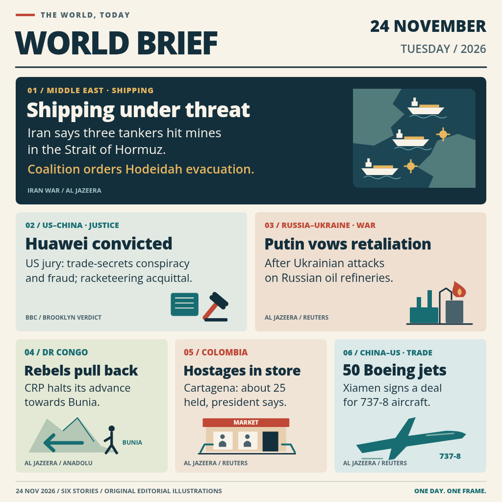

# World Brief — 24 November 2026

[](https://make.fun/bounty/news-image-20261124)
[](https://make.fun/bounty/news-image-20261124)
[](https://make.fun/bounty/news-image-20261124)

An original illustrated briefing of six stories reported on Tuesday, 24 November
2026, spanning the Middle East, Europe, Africa, the Americas, technology and trade.
The image preserves attribution for claims and distinguishes a threat from an
event that has already happened. See [SOURCES.md](SOURCES.md) for dated reporting.



Run with Python 3.13 and its standard library:

```sh
python3 main.py
```

The program writes `/output/entry.png`. For a local directory:

```sh
MAKEFUN_OUTPUT_DIR=out python3 main.py
```

The runtime uses the committed PNG, makes no network requests, installs nothing,
and produces the same bytes every run. The SVG and its generator are included so
the artwork can be edited and rebuilt. To rebuild, use Python 3 and local
Chromium with DejaVu Sans installed:

```sh
python3 build_art.py
```

The drawings are original symbolic illustrations, not documentary photographs
or geographically precise maps. No external images or fonts are fetched.
Code and original artwork are licensed under MIT.
